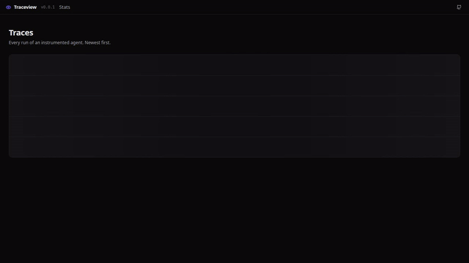
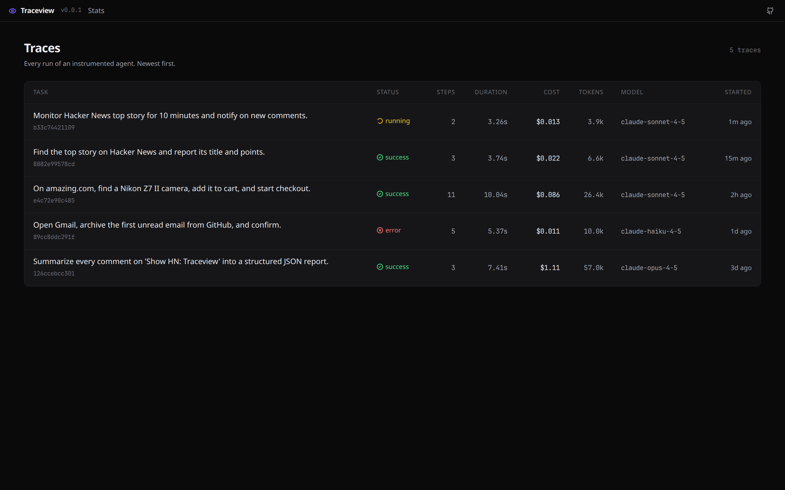
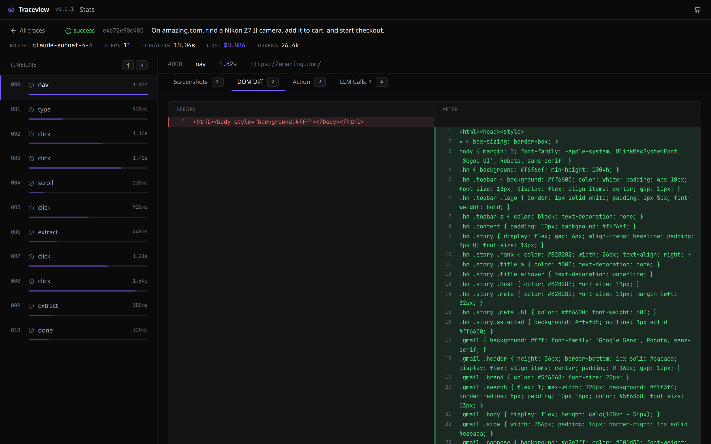
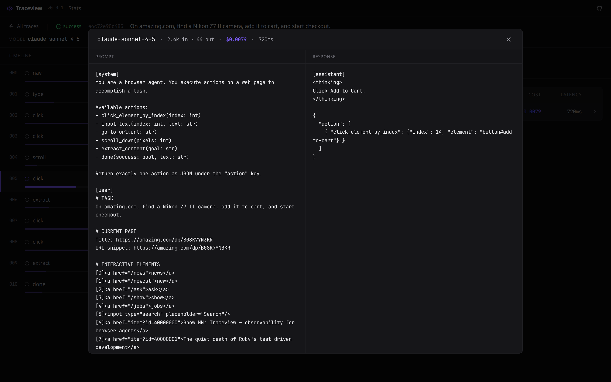

<div align="center">

# 👁 Traceview

[](https://github.com/MichaelTheMay/traceview/blob/main/LICENSE)
[](https://www.python.org/)
[](tests/)

**A flight recorder for your browser agents.**

Your agent clicked something, the page changed, a model got called, and then it crashed on step 9. Traceview captures every one of those moments — the DOM, the screenshot, the exact prompt, the cost — and plays it back in a viewer that runs entirely on your machine. One line of instrumentation, no cloud, no account.



</div>

---

## Quickstart

```bash
pip install git+https://github.com/MichaelTheMay/traceview
playwright install chromium
```

Wrap any [Browser Use](https://github.com/browser-use/browser-use) agent with a single call:

```python
import asyncio
import traceview
from browser_use import Agent
from browser_use.llm import ChatAnthropic

async def main():
    agent = Agent(
        task="Find the top story on Hacker News and return its title.",
        llm=ChatAnthropic(model="claude-sonnet-4-5"),
    )
    traceview.instrument(agent)   # <- the whole integration
    await agent.run()

asyncio.run(main())
```

Then open the recorder:

```bash
traceview view
```

A viewer lands at `localhost:7842` with every step your agent took, newest run first.

---

## The problem

Browser agents fail constantly. Browser Use, Claude in Chrome, Operator, Skyvern — they all crash on step 7 of a 12-step workflow and hand you a stack trace that says nothing about *why*.

The answer is almost always in the state you didn't capture: the DOM at the moment it broke, the screenshot before and after the click that missed, the prompt the model actually saw when it picked the wrong button, the token bill of the retry loop that spiraled. By the time you notice, the browser is closed and the context is gone.

Traceview records all of it as the agent runs, so you can scrub back through the run instead of reproducing it.

---

## What gets recorded

For every step the agent takes:

| | |
|---|---|
| **DOM before / after** | Side-by-side diff with line-level highlighting |
| **Screenshots before / after** | Compare slider to see exactly what moved |
| **The action** | Structured JSON of what the agent tried to do |
| **LLM calls** | Model, tokens, cost, latency, full prompt and response |
| **Errors** | Pinned to the step they happened on, not buried in a trace |

Everything is written to SQLite plus flat files under `~/.traceview/`. Nothing leaves the machine.

---

## A look inside


*Every run, with status, step count, and cost at a glance.*


*A real side-by-side DOM diff — see exactly what the page did between steps.*


*The full prompt and response for every model call. With the price tag.*

---

## How it works

Traceview monkey-patches your agent's `step()` method with a thin instrumentation layer. Before each step it snapshots the page (DOM + screenshot); after each step it records the action, the latency, and any error. LLM calls are picked up through [OpenLLMetry](https://github.com/traceloop/openllmetry)'s OpenTelemetry instrumentation of the Anthropic and OpenAI SDKs, then attached to the correct step via a `ContextVar`.

Storage is SQLite for metadata plus flat files for DOMs and screenshots, all under `~/.traceview/`. The viewer is a static Vite bundle served by a local FastAPI process. No cloud, no auth, no phone-home.

Pricing for Claude Sonnet 4.5 / Opus 4.5 and the common OpenAI models is built in. An unknown model logs at `$0` and raises a warning so the gap is visible instead of silent.

---

## CLI

```bash
traceview view              # open the viewer at localhost:7842
traceview ls                # list recent traces in the terminal
traceview rm <trace_id>     # delete a single trace
traceview rm --all          # delete every trace (asks first)
traceview config            # show config path and current settings
```

Telemetry is off by default and there is no switch to turn it on. Traceview never makes a network request you didn't ask for.

---

## Examples

Four runnable recipes in [`examples/`](examples/):

- [`hn_top_story.py`](examples/hn_top_story.py) — a simple successful run
- [`form_fill.py`](examples/form_fill.py) — a contact form with several inputs
- [`multi_tab.py`](examples/multi_tab.py) — an agent working across two tabs
- [`intentional_failure.py`](examples/intentional_failure.py) — a deliberately failing run, to show what an error trace looks like

Want to explore the viewer without spending a cent on API calls? Seed it with synthetic traces:

```bash
python scripts/seed_demo.py   # generates five realistic traces, zero API calls
traceview view
```

---

## Roadmap

Roughly in order:

- **Share links** — `traceview share <trace_id>` to upload a trace to a hosted viewer and drop it into a bug report. *(The client exists; point `share_endpoint` at your own self-hosted collector — there is no public one.)*
- **More frameworks** — Playwright-based agents first, then Claude in Chrome event streams
- **Regression detection** — run the same task across two model versions, diff the traces, flag drift
- **Cost dashboards** — aggregate spend across traces and tasks

Full backlog: [`BACKLOG.md`](BACKLOG.md).

---

## Contributing

The SDK and the viewer are both small enough to read in an afternoon. See [`CONTRIBUTING.md`](CONTRIBUTING.md) for dev setup. Running `python scripts/build_viewer.py` then `pip install -e '.[dev]'` and `pytest` gets you a working checkout (82 tests, all green).

---

## License & credit

MIT — see [`LICENSE`](LICENSE).

Traceview is a rebrand of and builds directly on [**witness**](https://github.com/EricFinland/witness) by Eric Catalano, also MIT licensed. All credit for the original design and implementation is theirs.
